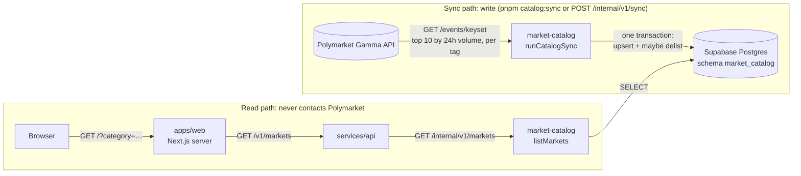

# Paper Prediction League

A public paper-trading league for political prediction markets. Every player gets 10,000 **Power** (the league's
fictional currency) and trades YES/NO shares at real Polymarket order-book prices. Every player is a country on a shared
map; a country's size is its share of all Power. **Everything is simulated: there are no deposits, withdrawals, wallets,
or real-money orders.** ("Power" is only what users see; stored identifiers keep their original names so existing
accounts, balances and grant history are untouched, and no second grant is ever issued.)

**Current milestone: the first end-to-end political trade.** Preview and execute a paper trade against a live quote,
atomic accounting, portfolio, country size and global rank, and settlement from an official outcome. See
[docs/paper-trading.md](docs/paper-trading.md): commands, the two-browser demo, every policy, and one trade traced through the code.

**Then: the World and profile pictures.** Every player is a country circle on a shared, pannable and zoomable map whose area follows total Power, with optional profile pictures. See [docs/world.md](docs/world.md).

---

## Architecture

Four separate Node.js processes with explicit HTTP boundaries, plus one hosted Supabase Postgres database and Supabase Auth.

| Process | Port | Responsibility | Touches Postgres? |
|---|---|---|---|
| [`apps/web`](apps/web) | 3000 | Next.js + Tailwind catalog page. Calls the public API from the server. | No |
| [`services/api`](services/api) | 4000 | Public, client-facing Express API (`GET /v1/markets`, `/v1/me/trading-account`). Verifies Supabase access tokens. | No |
| [`services/market-catalog`](services/market-catalog) | 4100 (loopback only) | Polymarket integration, normalization, catalog storage and reads. Internal HTTP + one-shot sync CLI. | **Yes** (`market_catalog` schema) |
| [`services/trading`](services/trading) | 4200 (loopback only) | Accounts, the Power ledger, the 10,000 Power grant, paper-trade preview/execution, positions, valuation, league ranking, settlement. Asks market-catalog (HTTP) for quotes and official resolutions. | **Yes** (`trading` schema) |

[`packages/catalog-contract`](packages/catalog-contract/src/index.ts) holds the zod schemas for the catalog
HTTP contract. It's shared because all three processes need the same shape, and each one validates what it receives.



**Why the service boundary exists.** Only `market-catalog` knows about Polymarket and holds database credentials.
Polymarket's quirks, the catalog schema, and its correctness rules (atomic publishes, freshness) stay
behind one small interface that can change without touching the web app. The read path never calls Polymarket,
so the site keeps working on saved data when Polymarket is down.

**Why `services/api` exists while it's thin.** Today it validates the query and forwards to the catalog service.
Its cost is one extra local process and one extra HTTP hop (about a millisecond on localhost). In later milestones it becomes the single
client-facing API that combines catalog, portfolio, and league data and authenticates players. The browser and the
web app never need to learn about internal services or credentials.

**Docker-free.** This project uses no Docker, Docker Compose, Testcontainers, or local Supabase stack
(see [CLAUDE.md](CLAUDE.md)). The database is a hosted Supabase development project.

---

## Prerequisites (Windows)

- **Node.js 24+**: `node -v`
- **pnpm 12** (`packageManager` is pinned in package.json): `pnpm -v`. If it's missing, run `corepack enable`.
- A **Supabase** project you created on supabase.com (the free tier is enough for development).
- Internet access to `gamma-api.polymarket.com` for syncing.

## Setup (PowerShell)

```powershell
cd "C:\Users\<you>\Desktop\Prediction Market Paper"
pnpm install

# Create the local env files from the committed examples (the real files are git-ignored).
Copy-Item services\market-catalog\.env.example services\market-catalog\.env
Copy-Item services\api\.env.example services\api\.env
Copy-Item apps\web\.env.example apps\web\.env.local
```

### Put your Supabase connection string in `services/market-catalog/.env`

1. Open the Supabase dashboard and select your project.
2. Click **Connect** in the top bar.
3. Choose the **Shared pooler** connection, session mode on **port 5432** (it works over IPv4).
4. Copy the URI. It looks like
   `postgresql://postgres.<project-ref>:[YOUR-DATABASE-PASSWORD]@aws-…pooler.supabase.com:5432/postgres`
5. In `services/market-catalog/.env`, set `DATABASE_URL=` to that URI with your database password substituted.
   **Percent-encode special characters in the password** (for example, `@` becomes `%40`).
   If you've lost the password, reset it under **Project Settings → Database**.
6. Optional but recommended: in **Project Settings → Database → SSL Configuration**, click **Download certificate**,
   save it outside the repo, and set `DATABASE_CA_CERT_PATH=` to its path. Without it, the connection is still
   encrypted but the server certificate is not verified, and the service logs a warning.

`DATABASE_URL` exists only in `services/market-catalog/.env` and `services/trading/.env` (copy the same value into both, or
give the trading service its own database role later). The API and web app never receive it, and it never reaches the browser.

### Apply migrations (one command)

```powershell
pnpm db:migrate
```

This runs `supabase db push --remote=<DATABASE_URL>` using the Supabase CLI installed as a dev dependency.
It applies only migrations that haven't been applied yet, records them in `supabase_migrations.schema_migrations`,
and never resets or drops data. Running it again is safe and prints "Remote database is up to date".

**Verify in the dashboard:**
- **Table Editor** → schema dropdown → `market_catalog`: you should see the tables `markets` and `sync_runs`.
- **Database → Migrations**: version `20261120120000` (`market_catalog_initial`).
- Or in the **SQL Editor**: `select table_name from information_schema.tables where table_schema = 'market_catalog';`

`market_catalog` isn't exposed through Supabase's Data API (REST/GraphQL), and that's intentional:
only the catalog service reads it. RLS is enabled with no policies as defense in depth.

## Run it

```powershell
pnpm catalog:sync   # import the shortlist: 2 requests, at most 20 events / 40 questions (a few seconds)
pnpm dev            # starts web (3000), api (4000), market-catalog (4100), trading (4200) in one terminal
```

Open <http://localhost:3000>. Run `pnpm catalog:sync` again at any time: existing rows are updated in place.

## Accounts and the starting balance

Registration and sign-in use **Supabase Auth** (email + password). Each signed-in player gets one **trading account**
with a one-time grant of exactly **10,000 virtual credits**, recorded as the first row of an append-only **ledger**
(`trading.ledger_entries`). Available cash is the sum of the ledger; there is no separate balance column.

One-time setup (the services run without it, but sign-in will answer "not configured"):

1. Supabase dashboard -> **Authentication -> Sign In / Providers**: Email enabled, **Confirm email** on.
2. **Authentication -> URL Configuration**: Site URL `http://localhost:3000`; add `http://localhost:3000/auth/confirm` to Redirect URLs.
3. Optional but more robust: **Authentication -> Email Templates -> Confirm signup**, set the link to
   `{{ .SiteURL }}/auth/confirm?token_hash={{ .TokenHash }}&type=email` (works from any browser or device).
4. **Project Settings -> API Keys**: copy the Project URL and the **Publishable** key into `SUPABASE_URL` and
   `SUPABASE_PUBLISHABLE_KEY` in **both** `services/api/.env` and `apps/web/.env.local`. These are public values;
   never use the secret or `service_role` key anywhere in this project.
5. `Copy-Item services\trading\.env.example services\trading\.env`, fill in `DATABASE_URL`, then run `pnpm db:migrate`
   (it applies the `trading` schema migration too).

Then `pnpm dev`, open <http://localhost:3000>, choose **My account**, register, confirm your email, and sign in.
The dashboard shows your Power, portfolio and username (your country's name; every account gets a unique default you can change).
Not covered yet: profile pictures, resting orders, seasons.

## Commands

| Command | What it does |
|---|---|
| `pnpm dev` | Start all four processes in watch mode |
| `pnpm db:migrate` | Apply pending SQL migrations to `DATABASE_URL` |
| `pnpm catalog:sync` | One-shot sync. Exit code 0 = succeeded, 1 = failed/superseded |
| `pnpm lint` | ESLint (services + packages, then Next.js rules for web) |
| `pnpm typecheck` | `tsc` in every workspace |
| `pnpm test` | Deterministic tests: fixtures, fake HTTP, throwaway Postgres. **No network.** |
| `pnpm test:live` | Opt-in check against the **real** Polymarket API (detects upstream drift) |
| `pnpm build` | Typecheck everything + `next build` |
| `pnpm start` | Run the built web app and the services without watch mode |

The Express services run TypeScript directly on Node 24 (type stripping), so they have no compile step.
That's why the code uses erasable syntax only and imports use `.ts` extensions.

**Health checks:** `curl.exe http://127.0.0.1:4100/health` (catalog + database) and `curl.exe http://localhost:4000/health`.
**Public endpoint:** `curl.exe "http://localhost:4000/v1/markets?category=politics&limit=5"`.

---

## How the catalog stays correct

### Polymarket integration (verified 2026-11-20 against the docs and real responses)
- **Endpoint:** one request per category: `GET https://gamma-api.polymarket.com/events/keyset?tag_slug=…&closed=false&active=true&order=volume24hr&ascending=false&limit=10`. `next_cursor` is deliberately not followed.
- **Shortlist** ([`select-shortlist.ts`](services/market-catalog/src/sync/select-shortlist.ts)): events are deduplicated by provider ID (one event can be top-10 in both categories), then each event keeps its **2 most-traded eligible questions** by market-level `volume24hr` (missing counts as 0). Maximum: 20 events, 40 questions. Event volume says which *topics* are hot; market volume says which *questions* within a topic people trade. A hot event can hold 50+ markets, so the two rankings are separate steps.
- **Events vs markets:** an *event* ("Macron out by…?") contains *markets*, which are the tradable YES/NO questions
  ("Macron out by June 30, 2026?"). We store and display **markets**. `closed=false` filters events only.
  Open events routinely contain closed markets, so each market is checked individually.
- **Tags used:** `politics` (id 2) → Politics, and `pop-culture` (id 596, labelled "Culture" on Polymarket) → Pop culture.
  Configured in [`categories.ts`](services/market-catalog/src/categories.ts). Each run records the tags it used in `sync_runs.provider_tag_slugs`.
  About 190 markets carry both tags and get both categories.
- **Quirks handled:**
  - `outcomes` and `outcomePrices` arrive as **JSON-encoded strings**. Prices are matched to outcomes **by position**.
  - Pages with `limit` above 50 are served gzip-only and return 406 without `Accept-Encoding: gzip`.
  - Placeholder markets ("Will Person AC win…?") have no `outcomePrices` and are inactive.
- **Skipped with a diagnostic:**
  - malformed events or markets
  - markets that are not open
  - outcomes that are not exactly one "Yes" and one "No" (for example `["Labour","National"]`)
  - prices that are malformed or outside 0–1
  - unparseable end dates
- **Limits:** a 30 s timeout per request, and up to 4 attempts with exponential backoff that honours `Retry-After` on 429 and 5xx.
  Other 4xx responses fail immediately.

### Publishing rules ([`sync-run-store.ts`](services/market-catalog/src/catalog/sync-run-store.ts))
1. **Fetch everything first, then publish in one transaction.** An upstream failure halfway through writes no market
   rows. The run is recorded as `failed` and the previous catalog is untouched.
2. **Idempotent upserts.** `unique (provider, provider_market_id)` plus `on conflict do update`, so re-syncing never duplicates.
3. **No stale overwrite.** Publishes take a transaction-scoped advisory lock. If a newer run has already published,
   an older run is marked `superseded` and writes nothing.
4. **The latest shortlist replaces the previous one.** A successful run delists every market not on the new shortlist.
   That hides it but never deletes it or marks it resolved, so old rows remain as history. If either category fails, or yields
   no eligible question, the run is `failed` and the previous shortlist stays on screen.
5. **Two freshness facts.** "Last successful refresh" is the newest `succeeded` run, and "latest attempt" is the newest run
   of any status. The page shows a warning when a newer attempt failed or was partial.
6. Snapshot prices are labelled "Snapshot from last sync · not live" everywhere they appear.

---

## Trace one market

Open these files in order to follow a Polymarket response into a Postgres row and then onto the page.

**Sync path (write)**
1. [`services/market-catalog/src/sync-cli.ts`](services/market-catalog/src/sync-cli.ts): `pnpm catalog:sync` entry point. Loads config and calls `runCatalogSync`.
2. [`src/sync/run-catalog-sync.ts`](services/market-catalog/src/sync/run-catalog-sync.ts): `runCatalogSync` starts a run, loops over tags, merges categories, and decides complete vs partial.
3. [`src/polymarket/gamma-client.ts`](services/market-catalog/src/polymarket/gamma-client.ts): `fetchOpenEventPages` makes the paginated HTTP calls with timeouts and retries.
4. [`src/polymarket/gamma-schemas.ts`](services/market-catalog/src/polymarket/gamma-schemas.ts): boundary schemas for the fields we rely on.
5. [`src/polymarket/normalize-market.ts`](services/market-catalog/src/polymarket/normalize-market.ts): `normalizeGammaEvent` turns an event into `NormalizedMarket`s plus skip diagnostics (JSON-string decoding, YES/NO mapping).
6. [`src/catalog/sync-run-store.ts`](services/market-catalog/src/catalog/sync-run-store.ts): `publishSyncRun` runs the lock, upserts (`jsonb_to_recordset`), delists, and records the run status.
7. [`supabase/migrations/20261120120000_market_catalog_initial.sql`](supabase/migrations/20261120120000_market_catalog_initial.sql): the tables and constraints the data lands in.

**Read path**
8. [`apps/web/app/page.tsx`](apps/web/app/page.tsx): `CatalogPage` reads `?category=&cursor=` and calls `getMarketPage`.
9. [`apps/web/src/lib/public-api.ts`](apps/web/src/lib/public-api.ts): `getMarketPage` calls `GET /v1/markets` server-side and validates the response.
10. [`services/api/src/create-app.ts`](services/api/src/create-app.ts): the `GET /v1/markets` route validates the query and maps errors to the standard shape.
11. [`services/api/src/market-catalog-client.ts`](services/api/src/market-catalog-client.ts): `fetchMarketPage` makes the HTTP call to the catalog service and validates its response.
12. [`services/market-catalog/src/http/create-app.ts`](services/market-catalog/src/http/create-app.ts): `GET /internal/v1/markets`.
13. [`src/catalog/catalog-queries.ts`](services/market-catalog/src/catalog/catalog-queries.ts): `listMarkets` runs the keyset-paginated SQL, and `getCatalogFreshness` reads `sync_runs`.
14. Back in the web app: [`src/lib/catalog-notice.ts`](apps/web/src/lib/catalog-notice.ts) `describeCatalog` picks the UI state, and [`src/components/market-card.tsx`](apps/web/src/components/market-card.tsx) renders the question.

## Tests: what's fixture-based vs. live

| Suite | Data source |
|---|---|
| [`normalize-market.test.ts`](services/market-catalog/test/normalize-market.test.ts) | A **recorded** Gamma page ([fixture](services/market-catalog/test/fixtures/gamma-events-page.recorded.json), trimmed but with values unmodified) plus **hand-written** edge cases |
| [`select-shortlist.test.ts`](services/market-catalog/test/select-shortlist.test.ts) | Pure selection: event dedupe, top-2 questions per event, 20 events / 40 questions cap |
| [`gamma-client.test.ts`](services/market-catalog/test/gamma-client.test.ts) | Fake HTTP: one request with the right params, retries, 429/422 |
| [`catalog-sync.int.test.ts`](services/market-catalog/test/catalog-sync.int.test.ts) | Hand-written payloads + a **throwaway real PostgreSQL 17** (`embedded-postgres`, UTF-8, temp directory). Covers 2-request syncs, top-2 selection, duplicate imports, shortlist replacement with history kept, failed-category preservation, superseded runs, pagination, and non-ASCII text |
| [`services/api/test`](services/api/test/markets-route.test.ts) | Real HTTP against a fake catalog server: validation, error shape, no leaked internals |
| [`apps/web/src/lib/catalog-notice.test.ts`](apps/web/src/lib/catalog-notice.test.ts) | Pure UI-state logic |
| [`test/live/gamma-live.test.ts`](services/market-catalog/test/live/gamma-live.test.ts) (`pnpm test:live`) | **Real Polymarket API** |

Integration tests never touch the hosted Supabase project.

---

## Open questions and known limitations

- **Public-launch licensing (unresolved).** Reading Polymarket's public API for local development is one question.
  Republishing its market questions and prices on a public website is a separate one. Before any public launch,
  review Polymarket's Terms of Use and API terms, and get permission if needed, for displaying questions, prices,
  and outcomes, plus the attribution requirements. The UI already links each market to its source page.
- **Source links:** `https://polymarket.com/event/{event slug}` follows the format in Polymarket's docs examples.
  polymarket.com returns HTTP 200 even for unknown slugs, so individual links can't be checked automatically.
- **Ordering:** markets are sorted by soonest expected end. That surfaces open markets whose end date has already
  passed while they await resolution. They're labelled as such, but sorting them after upcoming markets would read better.
- **Sync scheduling:** syncs are manual for now (CLI or `POST /internal/v1/sync`). There's no scheduler yet.
